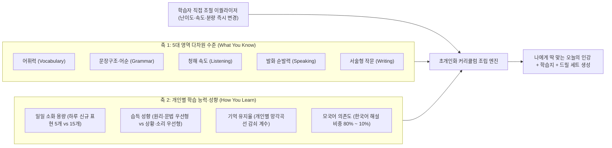
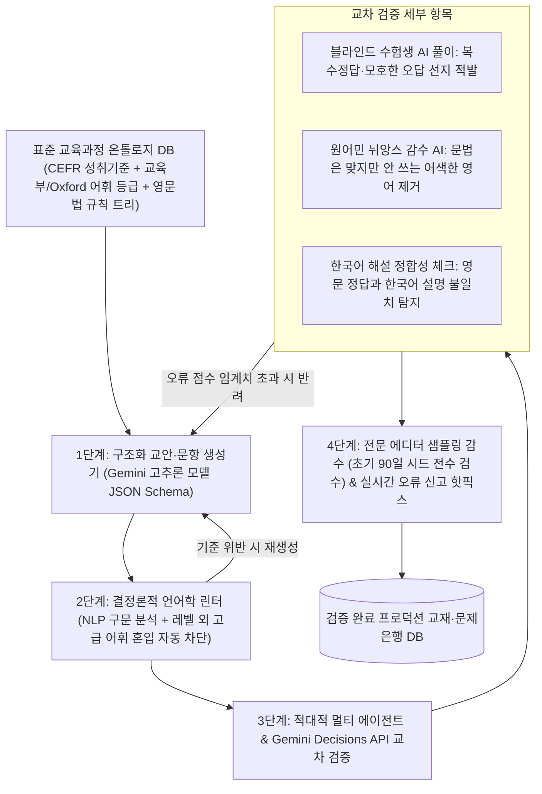
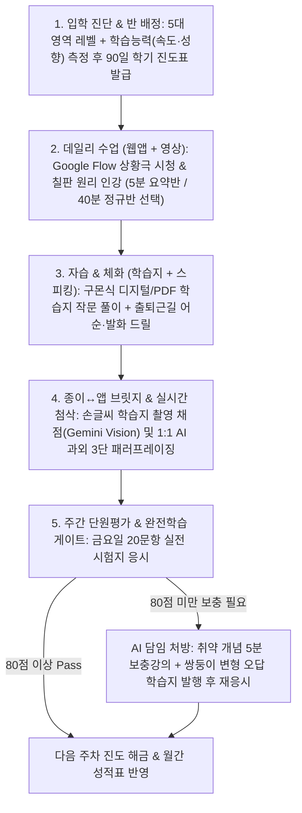

# 레거시 교육 × AI 웹앱 융합: 한국형 하이브리드 영어교육 플랫폼 v2.0 마스터 설계서

본 문서는 단순 퀴즈·회화 앱의 한계를 넘어 **기존 레거시 교육(학교·어학원·인강·구몬식 학습지·문제집·단원평가)의 검증된 교육학적 본질**과 **모던 AI 웹앱(초개인화 난이도 조절, 실시간 첨삭, Google Gemini & Google Flow 멀티모달 생성 파이프라인)**을 결합하기 위한 심층 디벨롭 설계안입니다.

---

## 1. 영어교육의 본질 재정의: 왜 '레거시 + 웹앱' 하이브리드인가?

기존 앱 중심 영어 학습과 전통 학원·학습지 교육은 각각 명확한 강점과 치명적인 결핍을 동시에 가지고 있습니다.

| 비교 영역 | 기존 모바일/웹앱 단독 교육 (듀오링고·스픽 등) | 기존 레거시 교육 (학교·어학원·인강·학습지·문제집) | **v2.0 하이브리드 플랫폼 결합 방향** |
| :--- | :--- | :--- | :--- |
| **지식의 체계성** | 파편화된 문장·퀴즈 나열로 머릿속에 전체 문법·어순 지도가 안 그려짐 | **학기제 진도표(Syllabus)**와 개념서→예제→유제→단원평가로 뼈대가 탄탄함 | **90일(1학기) 정규 학기제 진도표** + 단원별 개념 원리서 제공 |
| **학습 깊이 & 인출** | 블록 터치 위주라 '아는 것 같은 착각' 발생, 백지를 주면 한 줄도 못 씀 | 손으로 직접 쓰고 서술형 문제지를 풀며 **완전한 문장 구성력** 확보 | 웹 인터랙티브 풀이 + **태블릿/인쇄용 PDF 학습지·문제지 & 손글씨 AI 채점** |
| **개인차 대응** | 일률적 선형 코스이거나 단순 정오답 반복에 그침 | 한 교실/인강에서 모든 학생에게 같은 속도·난이도를 강제함 | **수준(Level) × 학습능력(Capacity) 2축 진단** 및 사용자 실시간 난이도 조절 |
| **콘텐츠 확장성** | 고정된 수백 개 레슨 완주 후 할 것이 없어 이탈 | 매년 개정판 출간 전까지 오래된 예문·시사 지문 유지 | **초기 3개월+ 검증된 코어 DB** + **매일 새벽 레벨별 맞춤 데일리 콘텐츠 발행** |
| **제작 비용·시각화** | 텍스트·음성 위주(영상 제작비 한계) | 고비용 스튜디오 촬영 및 디자이너 수작업 삽화·조판 | **Google Flow & Gemini** 기반 상황극 영상·삽화·맞춤 교재 반자동 팩토리 |

---

## 2. 개인별 '수준(Level)' × '학습 능력(Capacity)' 2축 초개인화 및 자기조절 시스템

사람마다 **"현재 알고 있는 지식의 높이(Level)"**와 **"새로운 지식을 받아들이고 소화하는 그릇·속도(Learning Capacity)"**가 완전히 다릅니다. 이를 분리 측정하고 학습자가 직접 미세 조절(Self-Calibration)할 수 있도록 설계합니다.

### 2.1 12단계 정밀 K-CEFR 레벨 체계 (초기초 파닉스 ~ 프로페셔널 C1)
기존의 모호한 초·중·고급 3단계 대신, 한국 정규 교육과정 및 국제 기준(CEFR/GSE)을 매핑한 **12단계 정밀 스케일**을 운영합니다.
* **Lv.1 ~ Lv.2 (Pre-A1 ~ A1 초)**: 기초 발음·연음 규칙, 주어+be동사/일반동사 현재형, 생존 필수 500단어 (영어 포기자·왕초보 재시작 반)
* **Lv.3 ~ Lv.4 (A1 말 ~ A2 초)**: 과거/미래 시제 즉각 전환, 전치사구 연결, 일상·여행 필수 의사소통 (초급 탈출 반)
* **Lv.5 ~ Lv.6 (A2 말 ~ B1 초)**: 조동사 뉘앙스, 현재완료, 관계절·간접의문문 어순 고정, 3문장 이유 설명 (중급 도약 반)
* **Lv.7 ~ Lv.8 (B1 말 ~ B2 초)**: 비즈니스 이메일·회의 완곡어법, 가정법·분사구문 실전 활용, 시사 요약 (오픽 IH~AL / 실무 반)
* **Lv.9 ~ Lv.10 (B2 말)**: 산업군별 전문 콜로케이션, 협상·트러블슈팅 설득 화법, 장문 에세이 작문 (글로벌 리더 반)
* **Lv.11 ~ Lv.12 (C1)**: 원어민급 이디엄·레지스터(격식도) 완벽 통제, 학술·시사 심층 반론 및 즉흥 스피치 (마스터 반)

### 2.2 적응형 진단(CAT) + 학습자 주도 '난이도 이퀄라이저 (Self-Control)'
1. **입학 시 CAT(문항반응이론 기반 적응형 테스트)**: 수십 문제를 똑같이 풀지 않고, 첫 문항의 정오답과 풀이 소요 시간에 따라 다음 문제의 난이도가 실시간으로 오르내리며 **5분 만에 5대 영역별 레벨 + 권장 일일 학습량**을 산출합니다.
2. **수업 중 '내 손으로 조절하는 4대 학습 컨트롤러'**: AI 추천에만 의존하지 않고 학습자가 컨디션과 체감 난이도에 따라 언제든 슬라이더를 조절할 수 있습니다.
   * **① 체감 난이도 스위치 (`쉽게 -1단계` / `적정` / `도전 +1단계`)**: 클릭 즉시 동일한 단원·주제를 유지한 채 문장 길이와 어휘 난이도가 내 수준에 맞게 재조정됩니다.
   * **② 학습 성향 모드 (`학원 원리파 모드` ↔ `실전 회화파 모드`)**: 원리파 선택 시 문법 구조 분석(S/V/O/C 표시)과 개념 설명 비중이 커지고, 회화파 선택 시 상황극 쉐도잉과 순발력 발화 비중이 커집니다.
   * **③ 진도 vs 복습 밸런스 (`진도 집중일` / `균형` / `복습·오답 데이`)**: 머리가 복잡한 날엔 새 진도를 멈추고 기존 학습지 오답과 복습만 소화할 수 있습니다.
   * **④ 한국어 보조 비율 (`친절한 한영 과외` ↔ `100% 영어 몰입 어학연수`)**: 중상급자가 한국어 힌트 없이 영영 풀이와 원어민 설명만으로 공부하도록 단계적 홀로서기를 지원합니다.

---

## 3. 초기 3개월+ 방대한 시드 DB 설계, 일일 업데이트 및 4중 정확도 검증(QA)

교육 서비스의 신뢰도는 **"풍부한 커리큘럼 볼륨"**과 **"단 하나의 문법·뉘앙스 오류도 허용하지 않는 정확도"**에서 결정됩니다.

### 3.1 런칭 전 필수 확보: '최소 3개월(90일 = 1학기) 코어 시드 DB' 구조
사용자가 첫날 입학하여 매일 공부해도 최소 3개월간 빈틈없이 이어지는 **정규 교과서(Core Textbook) 데이터베이스**를 사전 구축합니다.

* **학기 구성 (1개 레벨 기준 = 12주 / 90일 과정)**:
  * **월~금 (주 5회 × 12주 = 60개 정규 단원)**: 매일 새로운 핵심 문형·어순·어휘 진도 수업 + 일일 학습지
  * **토요일 (주 1회 × 12주 = 12회 주간 단원평가)**: 한 주간 배운 5개 단원 통합 복습 시험지(객관식+서술형+구술) 및 오답 클리닉
  * **일요일 / 월말 (월간 성취도 모의고사 3회 + 테마 특강 15회)**: 레벨 승급 심사 및 비즈니스/여행/시사 특별 에피소드
* **초기 시드 데이터 총량 목표 (코어 6개 대표 레벨군 우선 구축 기준)**:
  * 정규 단원(Unit): **360개 이상** (6개 레벨군 × 60단원) + 주간/월간 평가 세트 **90세트**
  * 검증된 핵심 문장 & 패러프레이징 쌍: **10,800문장 이상**
  * 레벨별 통제 필수 어휘·구동사: **6,000개 이상**
  * 단원별 문제은행 (어순 배열·빈칸·어법 선택·서술형 영작·딕테이션): **18,000문항 이상**

### 3.2 매일 새벽 공급되는 '데일리 라이브 부교재 (Daily Live Stream)'
90일 정규 과정이 '학교/학원의 본교재'라면, 매일 업데이트되는 콘텐츠는 **'살아있는 아침 영어 신문 & 일일 회화 학습지'** 역할을 합니다.
* 매일 글로벌 비즈니스·IT·문화·라이프스타일·일상 트렌드 토픽 3건을 선정하여, **동일한 스토리를 6가지 난이도 지문(Lv.1용 초단문 ~ Lv.12용 고급 논설문)으로 동시 변환**해 발행합니다.
* 덕분에 초보자도 어린아이용 동화가 아닌 **성인 지성에 맞는 최신 주제를 자기 수준에 맞는 쉬운 영어 문장**으로 매일 새롭게 읽고 말할 수 있습니다.

### 3.3 커리큘럼 및 문항 정확도 100% 보장: 4단계 무결성 검증 파이프라인 (QA Gate)

> [!IMPORTANT]
> **AI 환각(Hallucination) 및 출제 오류 원천 차단 원칙**
> 프롬프트 한 줄로 즉석 생성한 텍스트를 검증 없이 학생에게 노출하지 않습니다. 모든 교재·예문·문제지는 반드시 아래 **4중 자동·전문가 검수 파이프라인**을 통과해 `Verified` 서명을 받아야만 학습 DB에 적재됩니다.

---

## 4. Google Gemini & Google Flow 기반 '멀티모달 인강·삽화·학습지' 자동 제작 팩토리

글자만 가득한 딱딱한 화면이 아니라, **시각적 맥락(영상·삽화)과 손에 잡히는 교재(학습지·문제지)**를 압도적인 생산성으로 구축하기 위해 **Google Flow**와 **Gemini 멀티모달 API**를 이원화하여 결합합니다.

### 4.1 역할 분담: Google Flow (스튜디오 제작) vs Gemini API (실시간·배치 자동화)

| 제작 영역 | 활용 기술 스택 | 구체적 교육 콘텐츠 산출물 |
| :--- | :--- | :--- |
| **정규 시트콤 상황극 & 대표 인강 영상** | **Google Flow** (`Veo` + `Imagen` + `Scene Builder` + `Ingredients to Video`) | • **캐릭터 일관성 유지 영어 시트콤**: 고정 주인공(예: 뉴욕 마케터 *Chloe*, 동료 *Marcus*)이 90일 내내 등장하는 1~2분 실전 상황극 멀티샷 영상 • 카메라 구도·표정·입모양·현장 소음이 살아있는 몰입형 에피소드 |
| **칠판 판서 & 바이링구얼 강의 보이스** | **Gemini 고추론 모델** + **Gemini Flash TTS** | • 상황극 직후 이어지는 한/영 강사의 친절한 문장 해부 슬라이드 & 자연스러운 억양의 강의 내레이션 자동 합성 |
| **어휘·전치사 연상 삽화 & 웹툰 컷** | **Gemini Native Image / Imagen API** | • 한국어 번역 없이 그림만으로 `on / over / above` 차이나 구동사 뉘앙스를 직관적으로 이해시키는 **4컷 상황 일러스트** 및 **사진 묘사 스피킹 문제 이미지** |
| **데일리 뉴스 클립 & 발음 오디오** | **Gemini Omni Flash** + **Gemini TTS / Live API** | • 매일 새벽 생성되는 레벨별 오늘의 뉴스 요약 클립, 영국·미국·호주 등 다양한 원어민 성우 대화 음원 |
| **교재·학습지·시험지 PDF 조판** | **Gemini Structured JSON** + **HTML/Typst PDF 렌더링 엔진** | • 학원 자체교재·구몬 학습지·수능/토익형 시험지 레이아웃으로 자동 조판된 **인터랙티브 웹 워크북 & A4 인쇄/아이패드 필기용 PDF** |
| **종이 학습지 손글씨 자동 채점** | **Gemini Multimodal Vision** | • 출력해서 손으로 직접 쓴 영작 학습지·단어 시험지를 스마트폰으로 촬영하면 **손글씨 스펠링·문법 오류를 인식해 빨간펜 첨삭 및 앱 오답노트 자동 동기화** |

### 4.2 자동 발행되는 '레거시 4종 교재·학습지' 구성
모든 단원마다 버튼 하나로 웹 화면 풀이는 물론, 태블릿(굿노트 등) 및 프린터 인쇄가 가능한 **출판사급 4종 세트**가 제공됩니다.
1. **📘 [개념 원리서] 단원 요약 교과서**: 칠판 핵심 공식, 직독직해 끊어읽기(`/`) 표시 지문, 한국인 오답 주의보, QR코드 오디오 연동 단어장.
2. **📝 [일일 학습지] 구몬·눈높이식 단계별 훈련지**: 빈칸 채우기 → 문장 어순 재배열 → 시제/의문문 바꾸기 → 통문장 한영 영작으로 난이도가 촘촘하게 올라가는 쓰기 워크시트.
3. **💯 [단원평가 문제지] 학원 시험·실전 테스트**: 객관식 어법/어휘 문항, 대화문 빈칸 추론, 조건부 서술형 영작 문제지 + **별책 정답 및 문항별 상세 해설지**.
4. **📕 [나만의 쌍둥이 오답 프린트] 개인 맞춤 변형 문제지**: 학생이 이번 주에 틀렸던 문장들의 핵심 문법·패턴은 그대로 두고 **주어·단어·상황만 새롭게 바꾼 '쌍둥이 변형 문제(Twin Questions)'**를 Gemini가 실시간 생성해 완전히 내 것이 될 때까지 훈련.

---

## 5. '디지털 AI 어학원' 하이브리드 학습 사이클 (End-to-End 운영 모델)

학교·학원의 체계적인 관리 시스템과 웹앱의 자유도를 결합한 학습자의 실제 이용 흐름입니다.

---

## 6. 현실적인 단계별 구축 전략 (어디서부터 개발·디벨롭할 것인가?)

이 방대한 하이브리드 플랫폼을 한 번에 무리해서 만들기보다, **가장 임팩트가 큰 코어 엔진부터 3단계로 단단하게 확장**하는 것을 권장합니다.

* **Stage 1: 적응형 레벨·학습능력 엔진 & 레거시 학습지/시험지 시스템 결합 (우선 착수 권장)**
  * 현재 웹앱에 **12단계 레벨 × 학습능력(분량·원리파/회화파·해설 비중) 자기조절 컨트롤 패널** 탑재
  * 단원별 **[개념 원리서 + 구몬식 일일 학습지 + 단원평가 문제지 & 인쇄/PDF 출력 뷰]** 구현
  * 틀린 문제를 바탕으로 즉석 생성되는 **'쌍둥이 변형 오답 학습지'** 및 **주간 단원평가(Pass/Clinic) 성적표** 시스템 구축
* **Stage 2: Gemini API 백엔드 콘텐츠 팩토리 & 4중 정확도 검증(QA) 파이프라인 구축**
  * 커리큘럼 온톨로지 DB 스키마 설계 및 **초기 3개월(90일) 시드 커리큘럼 생성·4중 자동 검수 스크립트** 구축
  * Gemini 이미지 생성(상황 삽화·전치사 도식) + Gemini TTS(원어민 다중 성우) + 손글씨 학습지 촬영 채점(Gemini Vision) 연동
  * 매일 새벽 레벨별 데일리 시사·회화 학습지를 자동 생성·검수·발행하는 스케줄러 구축
* **Stage 3: Google Flow 시네마틱 상황극 시리즈 제작 및 고도화**
  * 대표 레벨 코어 단원부터 Google Flow(`Scene Builder` + `Ingredients to Video`)를 활용해 고정 캐릭터 기반 상황극 영상 에피소드 제작 및 인강 플레이어 통합
