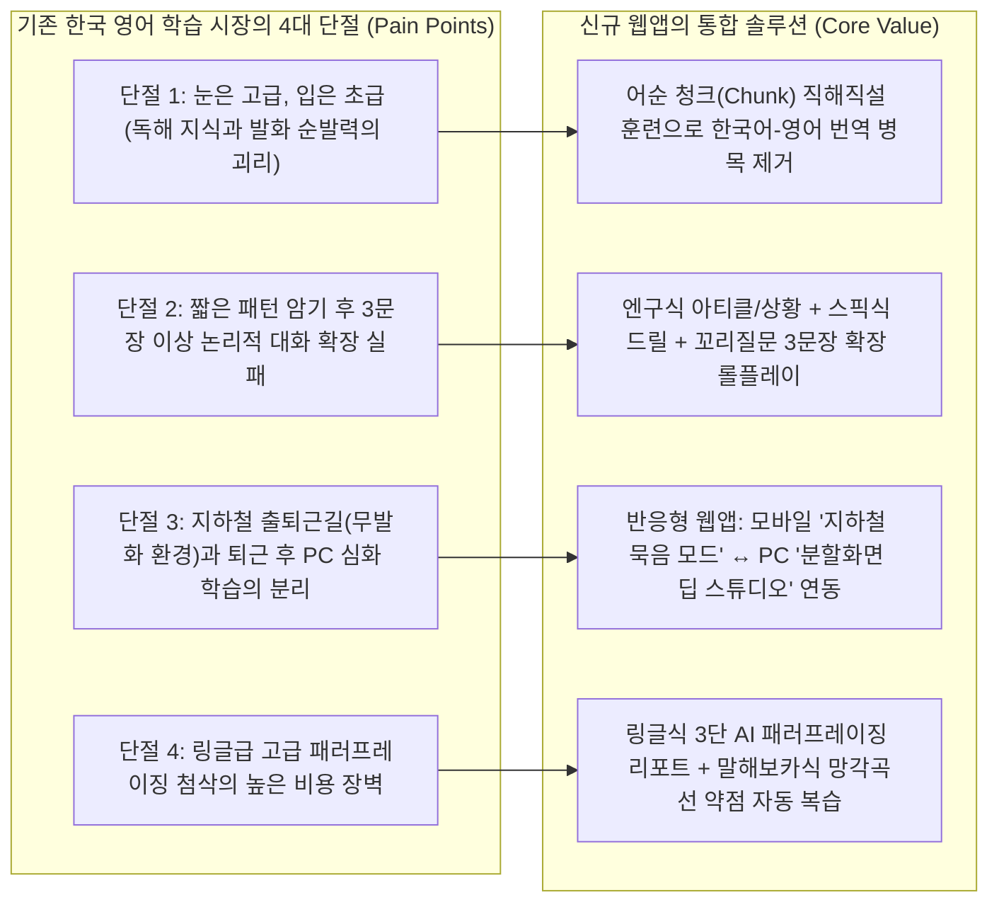
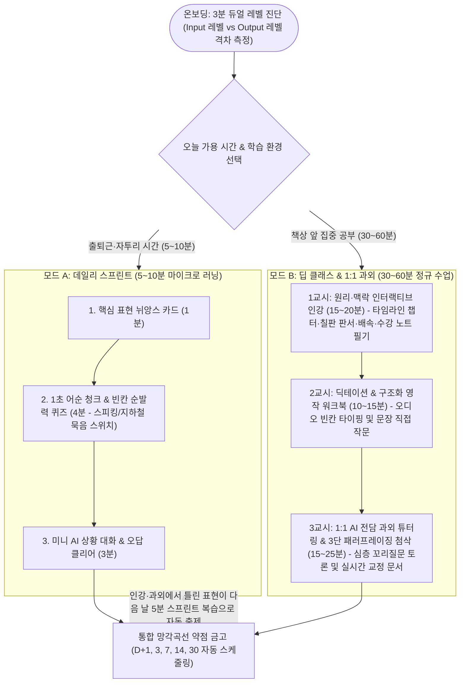
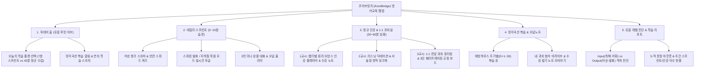
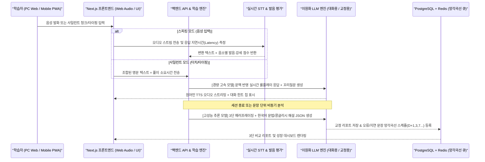

# 한국인을 위한 영어교육 웹앱(Web-App) 레퍼런스 분석 및 상세 기획안

본 문서는 한국 영어 학습 시장의 **웹(Web)** 및 **모바일 앱(App)** 레퍼런스를 전수 조사하여 각각 **가장 많이 사용되고 학습 효용성이 높은 TOP 3 서비스**를 선정·분석하고, 기존 서비스들의 강점과 빈틈(Pain Point)을 결합한 **차세대 한국인 맞춤형 영어교육 웹앱(Web-App) 상세 기획안**을 다룹니다.

---

## Part 1. 한국 기준 영어 학습 레퍼런스 조사 (웹 vs 앱 구분)

한국 성인·대학생·직장인 영어 학습 시장은 학습자의 **시간대 및 물리적 환경**에 따라 **웹(PC·태블릿 브라우저)**과 **모바일 앱(스마트폰)**의 역할이 뚜렷하게 이원화되어 있습니다.

* **웹(Web) 환경의 역할**: 책상 앞(집·오피스·카페·스터디룸)에서 **20~40분 이상 몰입하는 딥러닝(Deep Learning)**에 활용됩니다. 긴 호흡의 아티클 독해, 키보드 기반 딕테이션·영작, 분할 화면을 통한 원어민 1:1 화상 수업 및 실시간 문서 교정(Paraphrasing)에 강점이 있습니다.
* **모바일 앱(App) 환경의 역할**: 출퇴근 대중교통, 점심시간, 취침 전 등 **5~15분 단위의 마이크로러닝(Micro-learning)**에 활용됩니다. 짧은 퀴즈, AI 음성 발화 드릴, 스트릭(연속 학습) 및 리그전 기반의 습관 형성에 최적화되어 있습니다.

### 1.1 웹(Web) 기반 주요 영어 학습 서비스 레퍼런스 풀

| 카테고리 | 대표 서비스 | 주요 타겟 및 핵심 특징 | 과금 형태 |
| :--- | :--- | :--- | :--- |
| **1:1 화상 & 실시간 첨삭형** | **링글 (Ringle)** | 직장인·유학준비생 대상, 아이비리그 튜터 + 웹 공동 문서 실시간 패러프레이징 교정 | 유료 (회당/패키지) |
| **1:1 화상 & 온디맨드 회화형** | **캠블리 (Cambly)** | 24시간 즉시 연결 가능한 영미권 원어민 프리토킹 및 비즈니스/시험 슬라이드 수업 | 유료 (구독형) |
| **오픈 아티클 & 화상 연계형** | **엔구 / 엔구 데일리뉴스 (Engoo)** | 국내 영어 독학·스터디 활용도 1위 무료 웹 시사/회화 교재 + 가성비 1:1 화상영어 | 교재 무료 / 수업 유료 |
| **오리지널 영상 & 인강 결합형** | **리얼클래스 (RealClass)** | 애니메이션·영화·미드 원어민 영상 + 한국인 강사 해설 + 딕테이션·AI 발음 코칭 | 유료 (패키지/기기결합) |
| **원어민 현지 영상 & 습관형** | **스피킹맥스 (SpeakingMax)** | 현지 원어민 수천 명 인터뷰 영상 기반 따라 말하기 + 보상형 학습 루틴 시스템 | 유료 (패키지) |
| **글로벌 공공 아티클·오디오형** | **BBC Learning English** | *6 Minute English* 등 무료 고품질 리스닝 스크립트·어휘 해설 웹사이트 | 무료 |
| **영상 듀얼자막 확장 도구형** | **Language Reactor / Trancy** | 넷플릭스·유튜브 웹 브라우저에 한/영 동시 자막, 사전, 문장 북마크를 얹는 확장앱 | 부분 유료 (Freemium) |
| **발음·실제 용례 검색 유틸형** | **YouGlish / 해커스·산타 웹** | 특정 영단어·구문을 실제 유튜브 원어민 발화 구간으로 즉시 점프해 확인 / 시험 대비 | 무료 / 부분 유료 |

### 1.2 모바일 앱(App) 기반 주요 영어 학습 서비스 레퍼런스 풀

| 카테고리 | 대표 서비스 | 주요 타겟 및 핵심 특징 | 과금 형태 |
| :--- | :--- | :--- | :--- |
| **종합 게이미피케이션 루틴형** | **듀오링고 (Duolingo)** | 국내 어학 앱 MAU 1위, 스트릭·리그전 기반 초급~중급 마이크로 레슨 및 AI 콜 | 부분 유료 (Freemium) |
| **AI 초고밀도 스피킹 특화형** | **스픽 (Speak)** | 국내 AI 회화 매출 1위, 20분 100문장 발화 드릴 및 상황별 AI 튜터 롤플레이 | 유료 구독 (체험 제공) |
| **AI 적응형 어휘·문법·퀴즈형** | **말해보카 (Malhaeboka)** | 한국인 맞춤 어휘 4.5만 개·문법·리스닝 빈칸 퀴즈, 망각곡선 복습 및 뉘앙스 해설 | 유료 구독 (체험 제공) |
| **숏폼 영상 클립 표현 학습형** | **케이크 (Cake)** | 유튜브·영화·셀럽 숏폼 클립의 핵심 표현 3초 반복 재생 및 따라 말하기 | 부분 유료 (Freemium) |
| **AI 음소 단위 발음 교정형** | **엘사스픽 (ELSA Speak)** | 억양·강세·연음·취약 음소(`R/L`, `F/V` 등)를 소수점 단위로 정밀 진단하는 AI 코치 | 부분 유료 (Freemium) |
| **모바일 1:1 전화·화상 올인원** | **민병철유폰 (Uphone)** | 앱 내 예습 퀴즈 + AI 글로벌 뉴스 과정 + 외국인 강사 1:1 전화/화상 수업 결합 | 유료 구독 |
| **영상 쉐도잉 & AI 첨삭형** | **플랭 (Plang)** | 미드/영화 클립 무자막 유추 훈련 및 자유 스피킹 AI 문장 교정 특화 | 유료 구독 |
| **보상형 기초 영단어 암기형** | **똑똑보카** | 잠금화면·리워드 포인트 결합형 생활 밀착 기초 영단어 학습 | 무료 (광고/리워드) |

---

## Part 2. 핵심 레퍼런스 TOP 3 선정 및 커리큘럼·프로세스 분석

선정 기준은 **① 한국 내 실사용 규모(MAU·트래픽·시장 점유율)**, **② 실질적 영어 실력 향상 효용성(유료 전환율 및 완강·리텐션 검증)**, **③ 학습 설계 아키텍처의 독창성** 세 가지입니다.

> [!IMPORTANT]
> **선정 결과 요약**
> * **웹(Web) TOP 3**: **① 링글(Ringle)** [실시간 패러프레이징 첨삭], **② 리얼클래스(RealClass)** [원어민 영상+한국어 강의+딕테이션], **③ 엔구 데일리뉴스(Engoo)** [레벨별 아티클 인풋→토론 아웃풋 표준 교재]
> * **모바일 앱(App) TOP 3**: **① 듀오링고(Duolingo)** [게이미피케이션·습관화 1위], **② 스픽(Speak)** [초고밀도 발화·AI 롤플레이 1위], **③ 말해보카(Malhaeboka)** [적응형 퀴즈·한국어 뉘앙스·망각곡선 복습 1위]

---

### 2.1 웹(Web) TOP 3 커리큘럼 및 학습 프로세스 상세 분석

#### [Web 1] 링글 (Ringle) — *"내가 한 말을 원어민의 세련된 문장으로 실시간 재구성"*
* **커리큘럼 구조**:
  * **직무·목적별 모듈형 코스**: 비즈니스 미팅/이메일/협상, 산업군별 케이스 스터디, 글로벌 시사(경제·IT·문화) 아티클, 영어 면접(CV·인터뷰), 주재원/유학 대비 등 1,000개 이상의 자체 웹 교재 및 정규 트랙 운영.
  * **커스텀 업로드 수업**: 학습자가 본인의 발표 대본, 영문 이력서, 업무 문서를 직접 올려 교재로 활용 가능.
* **5단계 학습 프로세스**:
  1. **예약 및 수업 모드 커스터마이징**: 20분/40분 선택 후 수업 스타일(`교정 중심` vs `토론 중심`), 집중 피드백 영역(문법·어휘·발음), 튜터 요청사항을 사전 지정.
  2. **웹 예습 (Pre-class)**: 아티클 본문 및 요약본 리딩 → 핵심 토론 질문(3~5개)에 대해 영작해보기 → AI 튜터와 사전 스피킹 워밍업.
  3. **실시간 분할 화면 수업 (In-class)**: PC 웹 화면 좌측에는 화상 및 교재, 우측에는 **실시간 공유 문서(Ringle Docs)** 배치. 학습자가 말한 문장을 튜터가 그대로 받아적은 뒤, 즉시 그 아래에 **원어민식 패러프레이징(Paraphrasing) 교정문**을 타이핑하며 설명.
  4. **AI 정량 분석 (Analysis)**: 수업 종료 직후 AI가 학습자의 **발화 속도(WPM), 어휘 다양성·난이도, 문법 정확도, 필러워드(`um`, `uh`, `like`) 남발 빈도**를 수치화한 대시보드 제공.
  5. **입체 복습 (Review)**: 타임스탬프가 연동된 전체 녹음본·스크립트 다시 듣기, 핵심 교정 문장 쉐도잉, 수업 후 AI 리뷰 콜 진행.
* **시사점 및 한계**: 한국 중급 이상 학습자의 최대 고민인 *"콩글리시 탈피 및 세련된 문장 구사"*를 가장 완벽하게 해결하지만, **회당 2만~4만 원대의 높은 가격 부담**과 **초급자가 바로 영어로 토론하기 어려운 진입장벽**이 존재합니다.

#### [Web 2] 리얼클래스 (RealClass) — *"원어민 실제 맥락 영상과 한국인 맞춤형 해설의 결합"*
* **커리큘럼 구조**:
  * *위 베어 베어스*, *피너츠*, 영미권 영화·드라마·뉴스 등 라이선스 원어민 영상 콘텐츠를 **왕초보 → 초급 → 중급 → 고급/비즈니스** 단계별 코스로 편성.
* **5단계 학습 프로세스**:
  1. **무자막 영상 워밍업**: 전체 클립을 자막 없이 먼저 시청하며 상황과 비언어적 맥락을 스스로 추론.
  2. **한국인 전문 강사 강의**: 교과서적 번역이 아니라, **"왜 원어민이 이 상황에서 이 단어를 썼는지"** 문화적 배경, 어순 감각, 뉘앙스 차이를 한국어로 명쾌하게 해설.
  3. **딕테이션 트레이닝 (빈칸 타이핑)**: 영상을 다시 보며 대사 속 핵심 어휘·연음 구간의 빈칸을 키보드로 직접 입력해 문장을 완성(청해력 및 문장 구조 체화).
  4. **AI 스피킹 코칭**: 학습한 주요 문장을 직접 발화하면 AI가 잘못 발음한 단어와 놓친 **강세(Stress)·억양**을 짚어주고 '원어민 이해도 점수'를 산출.
  5. **실전 배틀 및 아카이빙**: 핵심 표현 인출 테스트를 거친 뒤, 모르는 단어와 문장을 `내 단어장 / 내 문장함`에 저장하고 전체 영상을 다시 보며 마무리.
* **시사점 및 한계**: 한국인이 이해하기 쉬운 친절한 맥락 설명과 딕테이션 훈련이 탁월하나, **수동적인 인강 시청 비중이 길어질 수 있고 정해진 영상 대사 외에 '나만의 문장'을 응용해 만들어내는 자유 발화 훈련이 부족**합니다.

#### [Web 3] 엔구 데일리뉴스 (Engoo Daily News) — *"인풋(독해·어휘)을 아웃풋(요약·토론)으로 전환하는 교과서"*
* **커리큘럼 구조**:
  * **10단계 세밀 레벨제**: Level 1~3(초급), Level 4~6(중급), Level 7~8(고급), Level 9~10(최고급)으로 세분화. 매일 최신 글로벌 비즈니스·과학·건강·문화 뉴스 업데이트 및 수천 개의 문법·회화·여행 웹 교재 무료 개방.
* **4단계 표준 프로세스**:
  1. **Exercise 1 — Vocabulary (선행 어휘)**: 본문 등장 핵심 어휘 6~8개의 발음 기호(오디오), 영영/한국어 뜻, 품사, 실용 예문을 먼저 익힘.
  2. **Exercise 2 — Article (청취 및 낭독)**: 원어민 오디오를 들으며 짧은 문단으로 구성된 아티클을 눈으로 읽고 소리 내어 따라 읽음(Shadowing/Reading Aloud).
  3. **Exercise 3 — Questions (사실 이해도 점검)**: 본문 내용을 정확히 파악했는지 묻는 3가지 Comprehension 질문에 답하며 본문 문장을 재조합해 봄.
  4. **Exercise 4 — Discussion (개인화 의견 확장)**: 주제와 연결된 5~6개의 열린 질문(*"당신의 나라에서는 어떤가요?"*, *"당신이라면 어떻게 하겠습니까?"*)을 통해 **배운 어휘를 내 생각 표현에 즉시 사용**하도록 유도.
* **시사점 및 한계**: 읽기·듣기(Input)와 말하기(Output)를 잇는 가장 이상적인 텍스트북 구조를 갖추어 국내 영어 스터디 점유율 1위이나, **웹에서 혼자 독학할 경우 Exercise 3~4의 내 답변을 들어주고 첨삭해 줄 인터랙티브 AI 파트너와 자동 복습 도구가 없습니다.**

---

### 2.2 모바일 앱(App) TOP 3 커리큘럼 및 학습 프로세스 상세 분석

#### [App 1] 듀오링고 (Duolingo) — *"이탈을 원천 차단하는 마이크로 레슨과 행동심리학 설계"*
* **커리큘럼 구조**:
  * **CEFR 기반 선형 경로(Linear Path)**: Intro(기초)부터 A1, A2, B1, B2까지 정렬된 `섹션(Section)` → 의사소통 목표별 `유닛(Unit)`(예: 카페에서 주문하기, 직장 동료에게 부탁하기) → 5~6개의 세부 `레벨/스텝`으로 구성된 단일 학습 트리.
  * **나선형 반복 구조(Spiral Curriculum)**: 문법 용어를 길게 설명하는 대신, 이전 유닛의 단어·문법 구조를 새 유닛 문장에 자연스럽게 섞어 체득하게 함.
* **핵심 학습 프로세스**:
  1. **진단 배치고사**: 첫 진입 시 적응형 테스트로 적절한 섹션/유닛으로 즉시 점프.
  2. **3~5분 멀티모달 마이크로 레슨**: 한 세션 안에 `[듣고 단어 블록 조합]` → `[그림/뜻 매칭]` → `[한국어 보고 영어 번역]` → `[원어민 문장 따라 말하기]` → `[짧은 대화문 빈칸 추론]` 등 10~15문항이 빠르게 교차 진행.
  3. **오답 클리어 강제 루프**: 레슨 도중 틀린 문제는 세션 맨 마지막에 다시 등장하며, **모든 오답을 맞혀야만 레슨 완료(XP 획득)** 처리.
  4. **게이미피케이션 리텐션**: 연속 학습일(`스트릭` 및 스트릭 프리즈 아이템), 오답 제한(`하트`), 매주 30명 단위로 묶여 승급·강등되는 `주간 리그(브론즈~다이아몬드)`, 친구 퀘스트 알림.
* **시사점 및 한계**: 매일 앱을 켜게 만드는 **습관 설계(Onboarding & Retention)**는 세계 최고 수준이나, 어순이 완전히 반대인 한국인 입장에서 **"왜 이 문장 구조가 되는지"에 대한 명쾌한 원리 해설이 부족**하고, 단어 블록 터치 위주라 **실전 스피킹 순발력으로 잘 이어지지 않는 한계**가 있습니다.

#### [App 2] 스픽 (Speak) — *"강의를 줄이고 20분에 100문장을 내뱉게 만드는 발화 엔진"*
* **커리큘럼 구조**:
  * 왕초보 탈출 ~ 중급·고급 정규 코스, 상황별 미니 코스(비즈니스, 해외여행, 스몰토크), 문법/보카 부스터, 그리고 학습자가 당장 필요한 상황을 입력하면 즉석에서 레슨을 만들어주는 **'나만의 수업(Custom Lesson)'**으로 구성.
* **3단계 핵심 프로세스 (`Learn - Practice - Apply`)**:
  1. **Learn (비디오 레슨, 5~7분)**: 미국 현지 튜터가 1:1로 눈을 맞추듯 핵심 패턴과 원어민 뉘앙스를 설명하고, 수동적 시청이 아닌 **강의 중간중간 즉시 입으로 따라 말해야 다음 장면으로 넘어가는 인터랙티브 구조**.
  2. **Practice (스피킹 연습, 5~7분)**: 방금 배운 핵심 패턴의 주어·시제·목적어를 계속 바꾸어가며 한국어 프롬프트를 보고 **즉각 영어로 발화하는 초고밀도 드릴(약 20분 기준 100문장 발화 분량)**.
  3. **Apply (실전 대화 & AI 튜터 롤플레이, 5분)**: 구체적인 시나리오와 **대화 미션 3가지**(예: *음료 사이즈 변경 요청하기*, *할인 쿠폰 문의하기*)가 주어지며, AI와 자유롭게 롤플레이 수행.
  4. **문장별 AI 피드백 및 스마트 리뷰**: 대화 종료 후 내가 말한 모든 문장에 대해 문법 오류와 더 자연스러운 원어민 표현을 교정해주고, 교정 문장만 모아 미니 스피킹 복습 레슨을 자동 생성.
* **시사점 및 한계**: 한국인의 고질병인 **'침묵 공포증'을 깨고 발화 근육을 단련하는 데 압도적 효용**을 보이지만, ① 대중교통 등 **말을 소리 내어 할 수 없는 출퇴근 공간에서 학습이 막히고**, ② 짧은 문장 패턴 위주라 **비즈니스/토론 수준의 긴 논리 전개 및 라이팅·리딩 통합 학습이 아쉽다**는 평가가 있습니다.

#### [App 3] 말해보카 (Malhaeboka) — *"한국인의 뉘앙스 갈증 해소와 망각곡선 알고리즘의 정점"*
* **커리큘럼 구조**:
  * CEFR 및 빈도순으로 정밀 설계된 **45,000개 영단어·숙어**, 핵심 **문법 패턴**, 다양한 성우/속도의 **리스닝**, 스토리 에피소드 기반 **실전 회화**가 유기적으로 연동.
* **핵심 학습 프로세스**:
  1. **20문항 실시간 적응형 진단**: 시작 시 20문제만 풀면 정오답 및 반응 속도를 분석해 학습자의 정밀 어휘 등급(CEFR 연동)을 산출하고 매 문제마다 난이도를 실시간 자동 조절.
  2. **10초 인출(Active Recall) 퀴즈**: 한국어 문장과 빈칸이 뚫린 영어 문장을 제시하고, 문맥에 맞는 정확한 영단어·어형(시제/수일치 포함)을 **음성 발화 또는 키보드 스펠링 타이핑**으로 맞힘.
  3. **한국인 특화 초정밀 오답·뉘앙스 노트**: 정답 확인 직후, 단순히 사전적 뜻만 보여주는 것이 아니라 **유의어 간 미묘한 뉘앙스 차이, 격식/비격식 여부, 자주 쓰이는 전치사 결합, 한국인이 흔히 착각하는 오용 사례**를 친절한 한국어 카드로 즉시 제공.
  4. **에빙하우스 망각곡선 자동 복습**: 한 번 학습한 단어·문장이라도 `첫 학습 여부 / 힌트 사용 여부 / 오답 횟수`를 추적하여 **기억이 희미해질 시점(망각곡선 주기)에 정확히 복습 큐로 자동 재출제**.
* **시사점 및 한계**: 한국인이 가장 가려워하는 **어휘·문법 뉘앙스 이해와 장기 기억 전환 효율이 최고 수준**이나, 낱말 빈칸 채우기 비중이 커서 **주어부터 끝까지 온전한 문장 전체를 스스로 조직해 길게 말하는 훈련으로의 연결 고리**가 약합니다.

---

### 2.3 웹 TOP 3 vs 앱 TOP 3 종합 비교 및 시장 기회(White Space) 도출

| 비교 항목 | 링글 (Web) | 리얼클래스 (Web) | 엔구 뉴스 (Web) | 듀오링고 (App) | 스픽 (App) | 말해보카 (App) | **신규 기획 웹앱 (목표)** |
| :--- | :---: | :---: | :---: | :---: | :---: | :---: | :---: |
| **핵심 강점** | 실시간 고급 패러프레이징 | 원어민 맥락+한국어 해설 | 체계적 아티클+토론 질문 | 습관 형성 게이미피케이션 | 초고밀도 발화+AI 롤플레이 | 한국어 뉘앙스+망각곡선 | **전 영역 핵심 강점 융합** |
| **인풋 (독해·청해·뉘앙스)** | ★★★★☆ | ★★★★★ | ★★★★★ | ★★☆☆☆ | ★★★☆☆ | ★★★★☆ | **★★★★★** |
| **아웃풋 (발화·영작 밀도)** | ★★★★☆ | ★★☆☆☆ | ★★☆☆☆ (독학 시) | ★★☆☆☆ | ★★★★★ | ★★★☆☆ | **★★★★★** |
| **문장 교정 & 패러프레이징** | ★★★★★ | ★★☆☆☆ | ★☆☆☆☆ (독학 시) | ★☆☆☆☆ | ★★★★☆ | ★★☆☆☆ | **★★★★★** |
| **장기 기억 복습 알고리즘** | ★★★☆☆ | ★★☆☆☆ | ★☆☆☆☆ | ★★★★☆ | ★★★☆☆ | ★★★★★ | **★★★★★** |
| **PC·모바일 연속성 & 무발화 대응** | PC 편중 | 태블릿/PC 편중 | PC/웹 편중 | 모바일 중심 | 발화 환경 필수 | 모바일 중심 | **심리스 크로스 모드 지원** |
| **비용 접근성** | 고가 (회당 과금) | 중~고가 (패키지) | 무료 (수업 별도) | 무료/저가 | 합리적 구독 | 합리적 구독 | **합리적 월 구독 (Freemium)** |

---

## Part 3. 한국인을 위한 영어교육 웹앱 프로그램 상세 기획안 (PRD)

### 3.1 프로덕트 개요 및 비전

* **프로덕트 명칭 (가칭)**: **코어브릿지 (KoreBridge) / 브릿지스픽 (BridgeSpeak)**
* **슬로건**: *"머릿속 한국어를 1초 만에 원어민의 세련된 영어로 — 출퇴근길 스마트폰에서 퇴근 후 데스크톱까지 이어지는 AI 영어 스튜디오"*
* **프로덕트 형태**: **반응형 크로스플랫폼 웹앱 (Responsive Web + PWA)**
  * 앱스토어 설치 장벽과 인앱 결제 수수료(15~30%) 부담 없이 URL 클릭만으로 즉시 체험 가능하며, 스마트폰 홈 화면 추가(PWA) 시 네이티브 앱과 동일한 풀스크린 UX·푸시 알림을 제공하고, PC/태블릿 접속 시 넓은 분할 화면(Split-View) 워크스페이스로 자동 전환됩니다.

#### 핵심 타겟 페르소나 (Target Personas)

| 구분 | 페르소나 A: 커리어 점프 직장인 (핵심 과금층) | 페르소나 B: 실전 스펙 취준생·대학생 | 페르소나 C: 일상·여행 자기계발 성인 |
| :--- | :--- | :--- | :--- |
| **연령 / 특징** | 26~42세 사무직·IT·외국계 재직/이직 희망자 | 20~27세 대학생, 오픽(IH~AL)·영어면접 준비생 | 25~50세 해외여행·외국인 친구·취미 학습자 |
| **현재 상태** | 영문 이메일·문서는 읽지만 화상회의·스몰토크에서 입이 얼어붙음 | 토익 점수는 높으나 자기 생각을 3문장 이상 자연스럽게 말하지 못함 | 왕초보~초급, 단어만 나열하거나 문법 걱정 때문에 말문을 못 틈 |
| **사용 패턴** | **출퇴근 지하철(모바일 10분 묵음 학습)** + **퇴근 후/점심 PC 웹(15분 스피킹·이메일/스크립트 첨삭)** | 노트북·태블릿 웹과 스마트폰을 오가며 고밀도 답변 구조화 훈련 | 스마트폰 중심으로 하루 10분 부담 없는 상황 회화 및 발음 교정 |

---

### 3.2 한국인 특화 커리큘럼 아키텍처 (`K-CEFR 하이브리드 커리큘럼`)

단순히 해외 원서를 번역한 커리큘럼이 아니라, **한국어 모국어 화자가 영어를 배울 때 겪는 언어학적 간섭(어순 역전, 주어 생략 습관, 전치사 감각 부재, 콩글리시 직역)**을 정면으로 돌파하도록 설계합니다.

#### 1) 5단계 레벨 체계 (CEFR + 한국인 체감 난이도 매핑)

| 레벨 | 명칭 | CEFR | 목표 역량 (Can-Do Statement) | 핵심 교정 포커스 |
| :--- | :--- | :--- | :--- | :--- |
| **Lv. 1** | **입트임 파운데이션** | A1 ~ A2 초 | 카페·공항·쇼핑 등 생존 상황에서 1초 내 기본 의사표현 가능 | **주어+동사 먼저 뱉기**, 기본 시제(과거/현재/미래) 즉각 전환 |
| **Lv. 2** | **어순 스위치 베이직** | A2 | 일상 스몰토크(주말·취미·음식·감정)를 2~3문장으로 자연스럽게 연결 | **전치사구·부사구 청크 확장**, 기본 구동사(`get`, `take`, `make`, `have`) 체화 |
| **Lv. 3** | **뉘앙스 브릿지 인터미디어트** | B1 | 내 경험과 의견을 이유(`because/so that`)와 함께 논리적으로 설명 (OPIc IM3~IH 수준) | **콩글리시 박멸**, 관계절·간접의문문 어순 고정, 유의어 뉘앙스 구분 |
| **Lv. 4** | **비즈니스 & 소셜 어드밴스드** | B2 | 업무 회의·협업 요청·트러블슈팅·시사 이슈에 대해 공손하고 설득력 있게 소통 (OPIc AL 수준) | **공손한 완곡 어법(Hedging)**, PREP(결론-이유-예시-요약) 발화 구조화 |
| **Lv. 5** | **네이티브 프로페셔널** | C1 | 임원급 발표·협상·심층 찬반 토론에서 원어민 수준의 관용표현과 세련된 패러프레이징 구사 | **고급 콜로케이션(Collocation)**, 미묘한 격식도(Register) 조절 및 즉흥 반론 |

#### 2) 3대 목적별 트랙 & 커스텀 트랙

1. **트랙 A [Real-Life & Travel]**: 해외여행 생존, 카페/식당/병원, 취미·일상 스몰토크, 감정과 리액션 200선
2. **트랙 B [Career & Global Work]**: 데일리 스탠드업 미팅, 일정 조율·거절·요청, 슬랙/이메일 실무 표현, 영문 이력서·영어 면접 디펜스
3. **트랙 C [Trend & Issue Talk]**:(엔구 데일리뉴스 벤치마킹) 매일 업데이트되는 IT·경제·라이프스타일 3분 브리핑 아티클 + 찬반 의견 말하기
4. **트랙 D [My Custom Studio]**:(링글+스픽 벤치마킹) 내일 당장 발표할 대본, 보낼 이메일 초안, 면접 예상 질문을 붙여넣으면 **30초 만에 나만의 어순 드릴 + 롤플레이 레슨으로 자동 변환**

#### 3) 모든 유닛에 탑재되는 '한국인 전용 3대 교정 장치'
* **① 어순 청크 블록 (Chunking Switch)**: *"어제 회사에서 팀장님이랑 급한 프로젝트 때문에 야근했어"*라는 문장을 통째로 영작하게 두지 않고, `[나는 야근했어 (I worked late)]` + `[팀장님이랑 (with my team lead)]` + `[급한 프로젝트 때문에 (on an urgent project)]` + `[어제 회사에서 (at the office yesterday)]`처럼 **원어민 사고 순서대로 한국어 블록부터 재배열**해 보여주는 시각적 어순 훈련.
* **② 콩글리시 & 직역 클리닉**: 한국인이 90% 틀리는 직역 표현 집중 교정 (예: *"약 먹었어?"* → ❌ *Did you eat medicine?* / ⭕ *Did you take your medicine?*, *"일정이 좀 애매하네"* → ⭕ *My schedule is a bit tight / tricky*).
* **③ 뉘앙스 온도계 (Formality & Nuance Meter)**: 말해보카 스타일의 한국어 해설에 더해, 같은 뜻이라도 친구에게 쓸 때(`Casual`)와 거래처/상사에게 쓸 때(`Polite Business`)의 표현 온도를 나란히 비교 제시.

---

### 3.3 투트랙 듀얼 학습 프로세스 (`5~10분 스프린트` × `30~60분 인강·과외 클래스`)

한국인 학습자의 일상은 **평일 이동 중 자투리 시간**과 **저녁·주말 책상 앞 집중 시간**이 공존합니다. 따라서 동일한 커리큘럼 유닛을 두 가지 깊이로 학습하고 데이터가 100% 상호 연동되는 **투트랙 듀얼 학습 체제(Dual-Depth Learning System)**로 설계합니다.

* **Track 1. 데일리 스프린트 모드 (`5~10분` — 듀오링고·스픽·말해보카형 마이크로 러닝)**
  * 바쁜 평일, 출퇴근길, 점심시간에 부담 없이 매일 접속해 **습관(스트릭)을 지키고 반사 신경을 깨우는 초단기 루틴**입니다.
* **Track 2. 딥 클래스 & 1:1 과외 모드 (`30~60분` — 리얼클래스 인강 + 링글·전담 과외형 심화 과정)**
  * 문제 풀이만으로는 채워지지 않는 **근본적인 영어 원리·문장 구조 강의 수강, 아티클 정독·딕테이션 워크북, 그리고 전담 과외 선생님과의 1:1 영작·스피킹 심층 첨삭**을 책상 앞에서 밀도 높게 수행하는 정규 수업입니다.

#### 모드별 상세 작동 메커니즘

1. **Step 0. 온보딩 — '듀얼 레벨(Dual-Level)' 정밀 진단 (최초 1회, 3분)**
   * 한국인의 특성을 반영해 **Input 점수(어휘·독해·문법 이해도)**와 **Output 점수(1초 순발력 어순 조합 + 자유 발화/작문)**를 분리 측정하여 격차(Gap)를 진단하고 맞춤형 주간 학습 플랜(예: *평일 7분 스프린트 4회 + 주말 45분 인강·과외 2회*)을 설계합니다.

2. **[모드 A] 데일리 스프린트 프로세스 (5~10분 완주)**
   * **핵심 카드 (1분)**: 오늘의 타겟 패턴 1개와 한국인이 헷갈리는 콩글리시·뉘앙스 포인트를 한눈에 스캔합니다.
   * **1초 순발력 하이브리드 드릴 (4~5분)**: 듀오링고·말해보카·스픽의 장점을 결합해 `[어순 청크 터치 조합]` → `[빈칸 핵심어 인출]` → `[변형 문장 즉각 발화]` 12~15문항을 몰입감 있게 돌파합니다.
     * 🎙️ **스피킹 모드** vs 🔇 **사일런트(지하철 묵음) 모드** 실시간 원터치 전환 지원.
   * **미니 실전 체크 & 오답 클리어 (2~3분)**: 3턴 내외의 짧은 실전 응답 미션을 수행하고, 도중 틀렸던 문장을 끝까지 다시 맞혀 스트릭과 XP를 획득합니다.

3. **[모드 B] 딥 클래스 & 1:1 과외 프로세스 (30~60분 집중 수업)**
   * **1교시 — 원리·맥락 인터랙티브 인강 (15~20분)**:
     * 한국인 일타 강사 스타일의 체계적인 **챕터별 강의 플레이어 & 디지털 판서 슬라이드** 제공 (`0.8x ~ 1.5x` 배속, 구간 반복, 타임스탬프 북마크 지원).
     * 단순 암기가 아니라 *"왜 원어민은 이 전치사를 쓰는지"*, *"어떻게 긴 한국어 생각을 영어 문장 뼈대에 얹는지"* 원리를 깊이 있게 이해하며 우측 **나만의 강의 노트**에 실시간 필기·저장합니다.
   * **2교시 — 아티클 정독 & 딕테이션·영작 워크북 (10~15분)**:
     * 엔구·리얼클래스 방식의 실전 대화문/시사 아티클 전체를 듣고, 연음·핵심 구문 구간의 **빈칸 딕테이션 타이핑**과 **주제 요약 서술형 영작(과외 워크북 과제)**을 직접 수행합니다.
   * **3교시 — 1:1 전담 과외 튜터링 & 링글식 3단 패러프레이징 첨삭 (15~25분)**:
     * 전담 과외 모드의 튜터가 워크북 영작 결과물과 라이브 스피킹 답변을 바탕으로 **꼬리질문(`Why?`, `Could you give an example?`) 심층 문답**을 이어갑니다.
     * 과외 칠판(공유 교정 문서)에 실시간으로 **3단 비교 첨삭 노트**가 기록됩니다:
       * 💬 **내 원문 (My Expression)**: *"Yesterday I had many works so I couldn't check your mail."*
       * 🔧 **문법·콩글리시 과외 첨삭**: *"Yesterday I had **a lot of work**, so I couldn't check your **email**."* (불가산 명사 `work` 및 `mail` vs `email` 원리 코멘트)
       * ✨ **원어민 실전 패러프레이징 (Casual / Business Polite 2종)**: *"Apologies for the delay — I was tied up with urgent tasks yesterday and just got to your email."*
   * **선순환 연동**: 30~60분 정규 수업에서 필기한 핵심 표현과 교정받은 문장들은 자동으로 **통합 망각곡선 금고**로 들어가, 다음 날 아침 출근길 **5~10분 스프린트 퀴즈**의 문제로 재출제됩니다.

---

### 3.4 웹앱(Web-App) 크로스 디바이스 UX/UI 설계

> [!TIP]
> **왜 네이티브 앱 단독이 아닌 '웹앱(Responsive Web + PWA)'인가?**
> **5~10분 데일리 스프린트**는 이동 중 스마트폰(모바일 웹/PWA)에서 가장 빛나고, **30~60분 인강 수강·딕테이션 타이핑·1:1 과외 첨삭 노트**는 저녁에 노트북이나 태블릿(PC 웹)을 펼쳤을 때 압도적인 학습 효율을 발휘합니다. 하나의 반응형 웹앱으로 두 경험을 완벽히 이어줍니다.

#### 1) 디바이스 및 학습 모드별 맞춤형 인터페이스

| 구분 | 🖥️ 데스크톱 / 태블릿 웹 (`30~60분 인강·과외 최적화`) | 📱 모바일 웹 / PWA (`5~10분 스프린트 최적화`) |
| :--- | :--- | :--- |
| **레이아웃 구조** | **2-Column / 3-Column 클래스룸 분할 뷰** • 좌측: 인터랙티브 인강 보드 / 아티클 / 1:1 과외 대화창 • 우측: 타임라인 챕터, 수강 필기 노트, 실시간 3단 첨삭 문서 | **단일 컬럼 풀스크린 집중 카드 뷰** • 한 손 엄지 조작 하단 액션 바 + 상단 프로그레스 바 • 모바일에서도 인강 오디오/슬라이드 미니 플레이어 완벽 지원 |
| **핵심 입력 방식** | 마이크 발화 + **물리 키보드 딕테이션·서술형 영작·필기** + 학습 단축키 | 원터치 어순 청크 조합 + 마이크 발화 + **지하철 사일런트 스위치** |
| **주력 학습 시나리오** | • 하루 30~60분 정규 원리 인강 수강 & 노트 정리 • 아티클 정독, 빈칸 딕테이션 및 1:1 과외 심층 첨삭 | • 출퇴근 5~10분 어순 순발력 스프린트 & 스트릭 달성 • 전날 인강·과외에서 배운 표현 망각곡선 복습 퀴즈 |

#### 2) 서비스 정보 구조 (IA — Information Architecture)

---

### 3.5 게이미피케이션 및 리텐션(습관 형성) 설계

듀오링고와 말해보카, 스픽에서 검증된 행동심리학 장치를 성인 한국인 학습자의 정서에 맞게 세련되게 도입합니다.

1. **누적 아웃풋 카운터 (`발화·조합 문장 수`)**: 단순 학습 시간(분)이 아니라 **"이번 달 내가 직접 만들고 뱉은 영어 문장: 1,420문장"**을 시각화하여 즉각적인 효능감을 제공합니다.
2. **유연한 스트릭 & '출퇴근 세이브'**: 바쁜 날에는 지하철에서 **'2분 망각곡선 복습 10문항(묵음 가능)'**만 완료해도 연속 학습 스트릭이 유지되도록 최소 허들을 낮춰 작심삼일 이탈을 방지합니다.
3. **응답 속도(`Response Latency`) 단축 뱃지**: 한국어 프롬프트를 보고 첫 영어 단어가 입에서 나오기까지 걸린 평균 시간(예: 첫 주 `4.8초` → 4주차 `1.6초`)의 단축 추이를 보여주어 *"머릿속 번역 시간이 줄어들고 있다"*는 확실한 성장 증거를 제시합니다.
4. **주간 티어 리그 & 스터디 그룹**: 비슷한 레벨·목표(직장인 비즈니스반, 취준생 오픽반 등) 유저 30명 단위로 주간 아웃풋 포인트(XP) 리그를 운영하고, 동료들과 '오늘의 패러프레이징 베스트 문장'을 익명 공유할 수 있는 가벼운 커뮤니티 피드를 제공합니다.

---

### 3.6 권장 기술 스택 및 AI 시스템 아키텍처

빠른 MVP 출시, PC·모바일 통합 유지보수성, 그리고 **유저당 AI API 원가 최적화**를 모두 만족하는 실무 아키텍처입니다.

#### 세부 기술 스택 구성안

* **Frontend (Web-App)**:
  * **Framework**: `Next.js (App Router)` + `TypeScript` (반응형 데스크톱/모바일 레이아웃 및 SEO·초기 로딩 최적화)
  * **Styling & Animation**: `Tailwind CSS` + `Framer Motion` (청크 블록 드래그·터치 애니메이션, 마이크로 인터랙션)
  * **PWA & Audio**: `Serwist / Workbox` (오프라인 캐싱·홈 화면 설치·웹 푸시 알림), `Web Audio API` (파형 시각화, 녹음 지연 최소화)
* **Backend & Database**:
  * **Server / BaaS**: `Next.js Server Actions / FastAPI` + `Supabase (PostgreSQL + Auth)`
  * **Spaced Repetition Engine**: 에빙하우스 SuperMemo(SM-2) 또는 FSRS(Free Spaced Repetition Scheduler) 알고리즘을 테이블로 구현하여 유저별 `next_review_at`, `ease_factor`, `stability` 자동 산출
  * **Vector Search**: `pgvector`를 활용해 학습자가 자주 틀리는 문법·콩글리시 패턴과 유사한 추가 드릴 문장을 코퍼스에서 즉시 매칭
* **AI 파이프라인 및 원가 절감(Unit Economics) 설계**:
  * **정규 드릴(Step 1~2) 사전 캐싱**: 모든 유저가 공통으로 학습하는 정규 레슨의 오디오(TTS), 어순 청크 데이터, 기본 뉘앙스 해설은 DB/CDN에 사전 생성·캐싱하여 **실시간 AI 호출 비용을 0원**으로 유지합니다.
  * **롤플레이·첨삭(Step 3~4) 모델 이원화**: 실시간 대화 턴에는 응답 속도가 빠르고 저렴한 경량 모델(예: Gemini Flash 계열 / GPT-4o-mini급)을 사용하고, 세션 종료 후 정밀 **3단 패러프레이징 및 한국어 뉘앙스 리포트** 생성에만 Structured Output(JSON Schema)이 강제된 고성능 모델을 호출하여 품질과 마진율을 동시에 확보합니다.

---

### 3.7 비즈니스 모델(BM) 및 단계별 개발 로드맵

#### 1) 수익 모델 (Freemium + Subscription + B2B)

| 플랜 | 월 요금 (예시) | 제공 범위 및 타겟 |
| :--- | :--- | :--- |
| **Free (무료 체험형)** | ₩0 | • 듀얼 레벨 진단 무제한 • 매일 데일리 아티클 1개 & 어순 청크 드릴 1세션 무료 • AI 롤플레이 및 3단 패러프레이징 리포트 일 1회 체험 |
| **Pro (개인 올라운더)** | 월 ₩19,900 (연간 결제 시 월 ₩12,900) | • 전 레벨·전 트랙 무제한 학습 (스피킹/사일런트 모드 완비) • 무제한 AI 롤플레이 & 링글식 3단 패러프레이징 교정 노트 • 망각곡선 자동 약점 복습장 무제한 & 내 자료 맞춤 레슨 월 20회 |
| **Studio Max (직장인·취준 집중)** | 월 ₩29,900 (연간 결제 시 월 ₩19,900) | • Pro 전체 혜택 + **핸즈프리 실시간 AI 전화영어 무제한** • 영문 이메일·발표 대본·면접 스크립트 업로드 심층 첨삭 무제한 • 음소 단위 정밀 발음/강세 클리닉 |
| **B2B Enterprise** | 인당 월 정액 계약 | • 기업 임직원 어학 복지용 관리자 대시보드(출석률·직무 트랙 이수율 리포트) |

#### 2) 3단계 구축 로드맵 (MVP → 고도화 → 확장)

* **Phase 1: Core MVP 구축 (1~6주차) — *"핵심 학습 루프 검증"***
  * 반응형 웹앱 골격 구축 (PC 분할 뷰 ↔ 모바일 카드 뷰 대응 + PWA 설치 지원)
  * Step 0 듀얼 레벨 진단 테스트 구현
  * 대표 유닛 샘플(일상 트랙 10유닛 + 비즈니스 트랙 10유닛 + 데일리 아티클 5선) 데이터 구축
  * **5-Step 학습 루프 완성**: 어순 청크 인풋 → 하이브리드 드릴(음성 발화 & 지하철 묵음 터치/타이핑 모드) → AI 롤플레이 → **3단 AI 패러프레이징 리포트** → FSRS 망각곡선 자동 복습 큐 연동
* **Phase 2: 개인화 & 리텐션 고도화 (7~10주차) — *"습관화 및 킬러 기능 탑재"***
  * **'내 자료 스튜디오(Custom Lesson Generator)'** 오픈: 사용자의 텍스트(이메일·면접 답변·대본) 입력 시 즉석에서 어순 드릴 + 롤플레이 생성
  * 핸즈프리 보이스 콜 모드 & 응답 지연시간(Latency) 트래킹 대시보드 추가
  * 스트릭 프리즈, 주간 리그전, 웹 푸시 알림(출퇴근 시간 맞춤 리마인더) 도입
* **Phase 3: 스케일업 & B2B 확장 (11주차 이후)**
  * 매일 자동 수집·가공되는 레벨별 트렌드 뉴스 아티클 파이프라인 자동화
  * 정밀 음소 단위 발음·강세 코칭 고도화 및 결제/구독 빌링 시스템(토스페이먼츠/Stripe) 정식 연동
  * 기업 교육(B2B) 어드민 포털 출시
